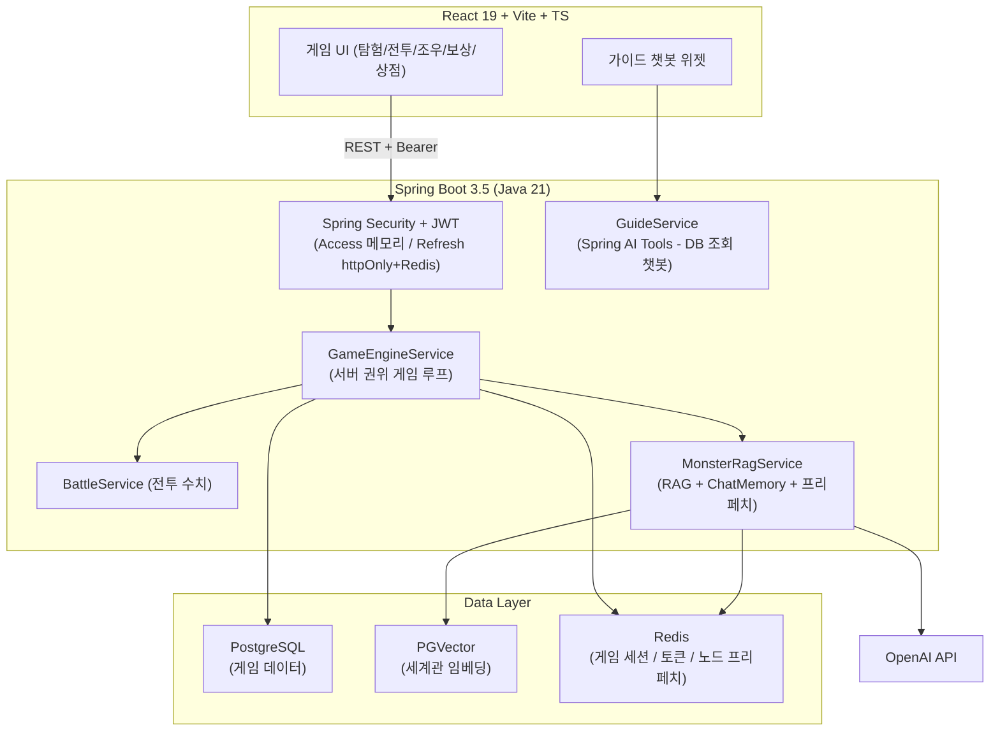

# Renova & Delve

> AI 스토리텔링 기반 로그라이크 웹게임 — 매 판마다 서사가 새로 쓰이는 '절차적 스토리텔링' RPG

**현재 버전: v0.9.0 (베타)** · 버전별 변경 내역은 [CHANGELOG.md](CHANGELOG.md) · 밸런스 측정은 [docs/balance.md](docs/balance.md)


## 프로젝트 소개

Renova & Delve는 LLM의 서사 생성 능력과 벡터 DB 기반 RAG를 결합한 **지능형 로그라이크**입니다.
천상(질서)과 마계(욕망) 사이에 낀 인간 왕국 레노바. 영생을 위해 악마와 계약한 왕 때문에 왕궁 지하에 마계의 문이 열렸고,
천상은 왕국을 통째로 정화하려 합니다. 플레이어는 5개 스테이지(각 10노드)를 내려가며 천상·마계·인간 중 누구의 방식으로
위기를 넘길지 고르고, 그 선택이 다음 장면의 서사와 결말을 바꿉니다.
(팀 프로젝트 당시에는 "악마와 계약한 왕 때문에 멸망한 왕궁에 잠입해 마계 포탈을 봉인한다"는 설정이었고, 천상·마계·인간 구도는 v0.2.0에서 더했습니다.)

핵심 설계 원칙은 **"비정형 서사 생성"과 "정형 수치 로직"의 분리**입니다.

- AI(RAG)는 노드의 **서사와 몬스터의 종류**만 결정합니다.
- 몬스터의 실제 능력치는 서버의 **필드 강도 시스템**(스테이지 × 난이도 확정 수치)이 부여합니다.
- 전투/보상/상점 등 모든 진행 상태는 **서버(Redis 세션)가 단일 소유**하며,
  클라이언트는 오직 "행동"만 보낼 수 있습니다. (조작 불가능한 서버 권위 구조)

## 프로젝트 이력

이 프로젝트는 **한 번 실패했다가 LLM으로 다시 살린 프로젝트**입니다.

| 시기 | 단계 | 내용 |
|---|---|---|
| 2026-05 ~ 07 | **v0.1 — 4인 팀 프로젝트** | 포트폴리오 목적의 팀 프로젝트로 시작. 게임 루프·서버 권위 원칙·아키텍처·API를 담은 **이 README(설계)**를 쓰고, 백엔드(엔티티·Repository, Spring Security(JWT), Spring AI(RAG·Tools))와 프론트엔드를 구현 |
| 2026-07 ~ 11 | **중단** | 팀원 간 실력 차이와 데드라인 초과로 미완성 상태에서 폐기. 게임 엔진은 설계대로 동작하지 않았다. 프론트엔드는 구현돼 있었지만 프로젝트가 무너지면서 저장소째 폐기되어, 남은 것은 백엔드 저장소뿐이었다 |
| 2026-11 ~ | **v0.2 ~ v0.9 — LLM 재구축** | "프롬프트 지시만으로 어디까지 되는가"를 확인하려고, 코드를 직접 쓰지 않고 LLM(Claude)에게 지시·검토하는 방식으로 다시 구현 중. 버전별 내용은 아래 |

### 사람이 한 일과 LLM이 한 일

요즘 현업의 흐름처럼 **구현은 LLM이, 방향 결정과 검토는 사람이** 맡았습니다.

- **팀 시절의 설계** — 이 README의 게임 루프, "AI는 서사, 서버는 수치"라는 분리 원칙, 서버 권위 게임 세션, 필드 강도 시스템, 다음 노드 프리페치, 시스템 아키텍처와 API 설계
- **팀 시절 원본으로 남아 있는 코드** — RAG 파이프라인(`MonsterRagService`의 압축기/확장기 분기·임계 점수 비교·프롬프트 설계), AI Tools(`GameTools`, 코드 그대로), JWT 유틸, 엔티티 20여 개의 테이블·FK 설계, Repository 쿼리
- **LLM이 다시 쓰거나 새로 만든 것** — 팀 README에 설계돼 있던 게임 엔진을 실제로 구현(서버 권위 구조), 프론트엔드 100%(팀 시절 프론트는 저장소째 폐기되어 다시 만듦), 회원·권한 체계, RDB → VectorStore ETL, 보안 결함 수정, 개인정보 처리, 도트 스프라이트 60종
- **사람이 한 것** — 무엇을 만들지 정하기, 직접 플레이하고 문제 찾기(스킬 교체 불가, 포션 버그, 관리자 자기 권한 회수 등), 모든 변경을 PR 리뷰로 받고 병합 결정

모든 변경은 기능 단위 PR로 올라가 있고, PR마다 "무엇을 했는지 / 무엇을 확인했는지 / 무엇을 확인하지 못했는지"와 리뷰가 남아 있습니다.

## 버전별로 만든 것

모든 버전은 두 저장소(백엔드·프론트)에 같은 이름의 git 태그로 남아 있습니다. 괄호 안은 PR 번호(백엔드 / 프론트)입니다. 세부 변경은 [CHANGELOG.md](CHANGELOG.md)에 있습니다.

| 버전 | 이름 | 한 줄 요약 |
|---|---|---|
| v0.1.0 | 팀 프로젝트 | 4인 팀 프로젝트가 멈춘 시점. 설계(README)와 엔티티·JWT·RAG 파이프라인. 게임은 설계대로 동작하지 않은 채 중단 |
| v0.2.0 | LLM으로 다시 세우기 | 서버 권위 게임 엔진, 프론트엔드 전체, 천상·마계·인간 세계관 |
| v0.2.1 | 안정화 | Flyway, 토큰 즉시 폐기, RAG 정확도 55% → 88% |
| v0.3.0 | 플레이 피드백 | 직접 플레이하며 나온 의견 반영: 스킬 교체, 조합 시너지, 계정 찾기, 전투 선택지 |
| v0.4.0 | 구조 정리와 기록 | SLF4J, OSIV 끔, 애그리거트 루트, 원정 통계, 도감 수집률 |
| v0.5.0 | 전생의 망령 | 패키지를 도메인별로 재구성, 첫 번째 고유 기능 |
| v0.6.0 | 레노바 연대기 | 원정마다 한 장씩 쌓이는 이야기책 |
| v0.7.0 | 악마의 계약서 | 지금 받는 혜택과 숨겨진 조항 |
| v0.8.0 | 왕국의 저울 | 모든 플레이어의 선택이 왕국의 정세가 된다 |
| v0.9.0 | 밸런스 조정 | 봇 시뮬레이션으로 난이도별 클리어율을 맞춤 |

### v0.1.0 — 팀 프로젝트 (2026-05 ~ 07)

- **설계**: 이 README의 원형을 이때 썼습니다. 게임 루프, 서사·수치 분리 원칙, 서버 권위 게임 세션, 필드 강도 시스템, 프리페치, 아키텍처, API 명세 ([당시 원문](https://github.com/vcg258/RenovaNDelve/blob/v0.1.0/README.md))
- **구현**: 백엔드는 엔티티 20여 개와 Repository, Spring Security(JWT), Spring AI(RAG 파이프라인, Tools). 프론트엔드도 구현돼 있었습니다
- 게임 엔진은 설계대로 동작하지 않는 미완성 상태로 중단됐고, 그때 프론트엔드 저장소는 폐기되어 지금은 백엔드 저장소만 남아 있습니다

### v0.2.0 — LLM으로 다시 세우기 (2026-11-13, #1 / #1)

- **서버 권위 게임 엔진**: 팀 README에 설계된 대로 전투·보상·상점 상태를 서버(Redis 세션)가 갖고, 클라이언트는 행동만 보냅니다. 팀 시절 코드에는 클라이언트가 보낸 게임 상태를 그대로 받는 구조가 섞여 있었습니다
- **프론트엔드 전체**: 팀 시절 프론트엔드는 저장소째 폐기되어 코드가 남아 있지 않아서, README의 화면 구성(탐험·전투·조우·보상·상점, 가이드 챗봇)을 따라 처음부터 다시 만들었습니다. React 19 + Vite + TypeScript, 도트 테마, 16x16 스프라이트 60종
- **세계관**: 천상 · 마계 · 인간. 조우 선택이 세력 성향으로 쌓이고 서사와 결말이 달라집니다
- **전투**: 적 행동 예고, 방어 태세, 보스 격노, 갈림길(정면 / 위험 / 은밀), 서약, 모닥불, 업적
- **AI**: RDB → VectorStore 증분 동기화(팀 설계의 파일 업로드 ETL을 대신함), 런 회고(Structured Output), 의미 검색 Tool, 가이드 가드레일
- **결함 수정**: 로그인만 하면 관리자 API를 부를 수 있던 인가 누락, 토큰 재발급이 항상 실패하던 문제, RefreshToken을 AccessToken처럼 쓸 수 있던 문제, 설정 파일의 시크릿

### v0.2.1 — 안정화 (2026-11-13, #2 #3 / #2)

- Flyway 도입(스키마는 Flyway만 바꾸고, JPA는 `validate`)
- 정지·권한 변경·탈퇴·로그아웃 시 AccessToken 즉시 폐기
- RAG 정확도: 몬스터 문서로 검색을 한정하고 질의를 키워드만으로, 임계 점수를 실측으로 조정 → 고른 몬스터가 유사도 상위 후보에 있던 비율 55% → 88%
- 게임 엔진 단위 테스트, 프론트 테스트(vitest) 도입

### v0.3.0 — 플레이 피드백 (2026-11-14, #4~#6 / #3~#5)

- 스킬 슬롯이 가득 찼을 때 교체, 스킬 조합 6종·유물 조합 9종 시너지
- 단계별 가호(성향 3 / 6 / 9), 세력·가호·조우 선택지 말풍선
- 아이디 찾기 / 비밀번호 재설정(메일), 회원가입에 이름·이메일
- 숨 고르기, 도망치기, 스킬 버리기, 원정 포기
- 갈림길 효과가 화면에 드러나지 않던 문제(서버에서는 적용되고 있었음)

### v0.4.0 — 구조 정리와 기록 (2026-11-15, #7~#10 / #6~#8)

- 로깅을 SLF4J로, OSIV 끔, `GameStateEntity`를 애그리거트 루트로, 전 메서드 JavaDoc
- 원정 통계(결과 화면), 도감의 미발견 칸과 수집률, 상태이상 말풍선, 문의 링크
- 포션을 마셔도 화면에 남던 문제, 관리자 본인 행에 정지 버튼이 보이던 문제

### v0.5.0 — 전생의 망령 (2026-11-15, #11 #12 / #9)

- **패키지 재구성**: MVC 계층별 → 도메인 모듈(`game / catalog / member / auth / collection / ranking / ai / global`) 안에 계층. 로직은 그대로
- **전생의 망령**: 쓰러진 원정이 망령으로 남아 다음 원정의 같은 자리에서 적으로 나타납니다. AI는 그 원정의 선택을 기억하는 등장 장면만 쓰고, 능력치·보상은 서버가 정합니다. 처치하면 그때의 유물을 되찾고, 세 번 달아나면 흩어집니다

### v0.6.0 — 레노바 연대기 (2026-11-15, #13 / #10)

- 원정이 끝날 때마다 연대기에 한 장이 쌓이고, 다음 장은 앞선 장을 이어받습니다
- 런 회고와 같은 LLM 호출의 구조화 출력 필드로 받아 호출 수가 늘지 않습니다
- 실측으로 프롬프트를 고쳤습니다: 앞 장을 이어받지 않던 문제, 스테이지 1 보스를 "왕"이라 부르던 문제

### v0.7.0 — 악마의 계약서 (2026-11-15, #14 / #11)

- 조우 자리에 가끔 마계의 계약서가 펼쳐집니다. 서명하면 혜택(골드·공격력·HP·유물)을 바로 받고, 대가는 숨겨진 조항 4종 중 하나로 나중에 발동합니다
- 조항은 서버만 알고 화면에는 "작은 글씨" 힌트만 보냅니다. 천상 성향 3 이상이면 골드를 바쳐 파기할 수 있습니다

### v0.8.0 — 왕국의 저울 (2026-11-15, #15 / #12)

- 지난 7일 동안 모든 플레이어가 택한 방식으로 왕국의 정세가 정해집니다(한 사람이 한 표)
- 정세 4종이 적 강도·보상에 약하게 작용하고, 첫 장면의 AI 서사에도 스밉니다. 원정을 시작할 때 고정됩니다

### v0.9.0 — 밸런스 조정 (2026-11-15, #16 / #13)

- **봇 시뮬레이션**: 실제 게임 엔진으로 봇 3종이 수천 판을 플레이하고, 그 결과로 수치를 정했습니다. 자세한 내용은 [docs/balance.md](docs/balance.md)

  | 난이도 | 목표 | 조정 전 | 조정 후 (신중형 봇) |
  |---|---|---|---|
  | 쉬움 | 60% | 100% | 약 62% |
  | 보통 | 30% | 100% | 33% |
  | 어려움 | 12% | 38% | 9~11% |
  | 지옥 | 3% | 0% | 4% |

- 함정이던 선택을 고쳤습니다: 위험한 길(클리어율 0% → 23%), 마계의 선택(2% → 31%, 흡혈 추가)
- 후속 정리: 배우는 순간 스킬 도감 등록, 결과 화면을 거치지 않은 원정의 연대기, 비밀번호 재설정 시 로그인 잠금 해제, 메일 재시도, 말풍선 위치 자동 조정, 모달 키보드 처리, 상태 바의 왕국 정세

### 다음에 할 일

- 직접 플레이하며 확인 (봇이 못 보는 손맛, 화면)
- 사망이 마지막 보스에 몰리는 구조, 난이도 간 적 능력치 차이
- 후보: 피해량 미리보기, 맵 미리보기, 가입 시 이메일 인증, 일일 도전(시드 고정), 몬스터 도감, 구글 로그인 완성

---

> **여기서부터는 팀 프로젝트 당시 작성한 README를 바탕으로 합니다.** (게임 루프 · 빠른 시작 · 시스템 아키텍처 · API 명세 · 기술 의사결정 · 프로젝트 구조)
> 당시의 설계는 그대로 두고, 이후 버전에서 실제로 바뀐 곳만 고친 뒤 *(v0.x)* 표시를 달았습니다. 당시 원문은 [v0.1.0 태그의 README](https://github.com/vcg258/RenovaNDelve/blob/v0.1.0/README.md)에 있습니다.

## 게임 루프

```
탐험(EXPLORE) ─ 전진 ─▶ AI 노드 생성
   ▲                      ├─ 전투/강적/보스(BATTLE) ─ 승리 ─▶ 보상(REWARD) ─▶ 상점(SHOP) ─┐
   │                      └─ 조우(ENCOUNTER) ─ 선택지 결정 ──────────────────────────────┤
   └──────────────────────────────────────────────────────────────────────────────────┘
패배 시 GAMEOVER (불사조의 깃털 보유 시 1회 부활) · 5-10 보스 처치 시 CLEAR
게임 종료 시: 도감 등록 + 랭킹 갱신 + AI가 이번 모험을 요약한 서사 제공
```

- 전투: 턴제. 스킬(쿨타임/단일·전체/상태이상: 출혈·화상·독·기절) + 소모품(턴 소모)
- 성장: 처치 경험치로 레벨업(HP/공격/방어 상승), 상점에서 장비 교체·스킬/유물 구매
- 유물: 서버 로직으로 동작하는 패시브 (골드 획득↑, 스킬 피해↑, 쿨타임↓, 피해 감소 등)
- 난이도: EASY(랭킹 미등록) / NORMAL / HARD / HELL — 적 강도와 보상 배율에 반영 *(v0.9.0: 봇 시뮬레이션으로 목표 클리어율에 맞춤, [docs/balance.md](docs/balance.md))*
- 전투 보강 *(v0.2.0~v0.3.0 추가)*: 적 행동 예고와 방어 태세, 보스 격노, 갈림길, 서약, 모닥불, 세력 성향과 가호, 스킬·유물 조합 시너지, 숨 고르기·도망치기
- **전생의 망령** *(v0.5.0 추가)*: 쓰러진 원정은 망령으로 남아, 다음 원정의 같은 자리에서 적으로 나타난다. AI는 그때 내린 선택을 기억하는 대사만 쓰고, 능력치·보상은 서버가 정한다. 처치하면 그 원정의 유물 하나를 되찾고, 세 번 달아나면 흩어진다
- **레노바 연대기** *(v0.6.0 추가)*: 원정이 끝날 때마다 한 장(章)이 쌓이는 나만의 이야기책. 기록관(AI)이 앞선 장을 이어받아 이번 원정의 선택으로 다음 장을 쓴다. 런 회고와 같은 호출의 구조화 출력 필드라 LLM 호출이 늘지 않는다
- **악마의 계약서** *(v0.7.0 추가)*: 조우 자리에 가끔 마계의 계약서가 펼쳐진다. 서명하면 혜택을 바로 받고, 대가는 서버만 아는 숨겨진 조항으로 나중에 발동한다. 서명 전에는 "작은 글씨" 힌트만 보인다. 천상 성향이 3 이상이면 골드를 바쳐 파기할 수 있다
- **왕국의 저울** *(v0.8.0 추가)*: 지난 7일 동안 모든 플레이어가 택한 방식(한 사람이 한 표)으로 왕국의 정세가 정해진다. 새 원정은 그 정세로 시작해 끝날 때까지 유지되고, 정세는 적 강도·보상에 약하게 작용하며 첫 장면의 서사에도 스민다

## 빠른 시작 (Quick Start)

### 사전 요구사항

| 항목 | 버전 | 용도 |
|---|---|---|
| Java | 21+ | 백엔드 |
| Node.js | 18+ | 프론트엔드 |
| Docker | 최신 | PostgreSQL(PGVector), Redis |
| OpenAI API Key | - | 서사 생성 / 임베딩 |

### 1. 인프라 실행 (Docker)

```bash
# PostgreSQL + PGVector (게임 DB + 벡터 스토어 통합)
docker run -d --name pgvector -e POSTGRES_PASSWORD=postgres -p 5432:5432 pgvector/pgvector:pg16
docker exec -it pgvector psql -U postgres -c "CREATE DATABASE renova_n_delve;"

# Redis (RefreshToken + 게임 세션 + AI 프리페치 캐시)
docker run -d --name redis -p 6379:6379 redis:7
```

### 2. 환경 변수

```bash
cd RenovaNDelve
cp .env.example .env
# JWT_SECRET_KEY, OPENAI_API_KEY 입력
```

**메일 (선택)** — 아이디 찾기·비밀번호 찾기 메일을 보내려면 `.env`에 SMTP 계정을 넣습니다. 비워 두면 서버는 그대로 기동되고 메일만 나가지 않습니다(로그에 경고).

```bash
MAIL_USERNAME=네이버_아이디
MAIL_PASSWORD=네이버_비밀번호_또는_애플리케이션_비밀번호
# MAIL_FROM=네이버_아이디@naver.com   # 비우면 MAIL_USERNAME@naver.com
# APP_BASE_URL=http://localhost:5173  # 재설정 링크가 가리킬 프론트 주소
```

- 네이버 메일 > 환경설정 > POP3/IMAP 설정에서 **POP3/SMTP 사용**을 켜야 합니다.
- 2단계 인증을 쓰는 계정은 네이버 계정 보안 설정에서 **애플리케이션 비밀번호**를 발급받아 넣습니다.
- 기본값은 `smtp.naver.com:465`(SSL)입니다. 587(STARTTLS)을 쓰려면 `MAIL_PORT=587`, `MAIL_SSL=false`.
- 계정 정보는 저장소에 넣지 않습니다(`.env`는 git에서 제외).

### 3. 백엔드 실행

```bash
./gradlew bootRun
```

- 서버: `http://localhost:8080` / Swagger: `http://localhost:8080/swagger-ui/index.html`
- 기동 시 Flyway가 스키마(`db/migration/V*.sql`)를 적용하고, 반복 마이그레이션 `R__seed_data.sql`이 몬스터/스킬/장비/유물/필드 강도 시드를 등록 (멱등, 내용이 바뀐 기동에서만 재실행) *(v0.2.1: 팀 시절에는 `db/data.sql`)*

### 4. 벡터 스토어 동기화 (자동) *(v0.2.0에서 변경)*

팀 시절 설계는 관리자가 세계관 문서를 업로드하면 청크 분할 → 임베딩하는 파일 ETL이었습니다. 문서를 올리지 않으면 벡터 스토어가 비어 RAG가 사실상 랜덤으로만 돌아서, 게임 데이터의 원본인 RDB를 그대로 임베딩하도록 바꿨습니다.

기동하면 RDB의 게임 데이터 7종(몬스터·무기·갑옷·투구·스킬·유물·소모품)이 VectorStore와 자동으로 동기화됩니다.
바뀐 행만 다시 임베딩하므로 2회차 기동부터는 임베딩 API 호출이 거의 없습니다. 로그에서 `[GameDataETL] RDB 동기화 완료`를 확인하세요.

```
POST   /api/admin/etl/sync?force=false   # 수동 동기화 (force=true면 전부 다시 임베딩)
DELETE /api/admin/etl/purge              # RDB로 만든 문서 전체 삭제
```

AI 호출이 실패하거나 어울리는 몬스터를 찾지 못해도 게임은 동작합니다. (랜덤 몬스터 + 기본 서사로 폴백)

### 5. 프론트엔드 실행

```bash
cd ../renova-delve-front
npm install
npm run dev
```

- `http://localhost:5173` 접속 — `/api`는 Vite 프록시로 8080에 전달되어 CORS/쿠키 문제 없음

## 시스템 아키텍처



### 레이턴시 최적화

노드 진입 시 AI가 **다음 노드를 비동기로 미리 생성**(`AsyncPrefetchService`)해 Redis에 캐시합니다.
플레이어가 전투/상점을 진행하는 동안 다음 서사가 준비되므로 체감 대기가 거의 없습니다.
소비된 캐시는 즉시 삭제되어 같은 노드 재사용(리플레이)을 방지합니다.

## API 명세 (요약)

> 상세 스키마는 Swagger UI 참고. `/api/auth/**` 외 전부 JWT 필요.

| Method | URL | 설명 |
|---|---|---|
| POST | `/api/auth/signup` | 회원가입 |
| POST | `/api/auth/login` | 로그인 → `{accessToken}` + Refresh 쿠키 |
| POST | `/api/auth/refresh` | AccessToken 재발급 (쿠키 기반) |
| POST | `/api/auth/logout` | RefreshToken 폐기 |
| GET | `/api/member/me` | 내 정보 |
| GET | `/api/game/options` | 세팅 옵션 (장비/스킬/유물 + 예산 800pt) |
| POST | `/api/game/new` | 새 게임 (예산 서버 검증) |
| GET | `/api/game/current` | 현재 게임 뷰 (새로고침 복원) |
| POST | `/api/game/next` | 다음 노드 전진 (AI 생성) |
| POST | `/api/game/battle/skill` | 스킬 사용 (1턴) |
| POST | `/api/game/battle/consumable` | 소모품 사용 (턴 소모) |
| POST | `/api/game/encounter` | 조우 선택지 결정 |
| POST | `/api/game/reward` | 보상 선택 (SKIP 가능) |
| GET/POST | `/api/game/shop`, `/shop/buy`, `/shop/leave` | 상점 |
| GET | `/api/game/summary` | 종료 요약 (AI 서사 요약) |
| POST | `/api/game/abandon` | 게임 포기 |
| GET | `/api/ranking?difficulty=` | 난이도별 TOP 10 |
| GET | `/api/collection` | 내 도감 |
| POST | `/api/rag` | 가이드 챗봇 (Tools 기반 DB 조회) |
| ~~POST~~ | ~~`/api/admin/etl`~~ | ~~세계관 문서 ETL 업로드~~ → v0.2.0에서 `/api/admin/etl/sync`(RDB → VectorStore 동기화)로 대체 |

**이후 추가된 API**

| 버전 | Method | URL | 설명 |
|---|---|---|---|
| v0.2.0 | POST | `/api/admin/etl/sync` | RDB → VectorStore 동기화 (관리자) |
| v0.2.0 | POST | `/api/game/battle/guard` | 방어 태세 |
| v0.2.0 | POST | `/api/game/rest` | 모닥불 선택 (휴식 / 단련 / 서원) |
| v0.2.0 | GET | `/api/game/review` | AI 런 회고 |
| v0.3.0 | POST | `/api/auth/find-id` | 아이디 찾기 (이름 + 이메일 → 메일 발송, 응답은 항상 같음) |
| v0.3.0 | POST | `/api/auth/password-reset/request`, `/confirm` | 비밀번호 재설정 링크 요청 / 1회용 토큰으로 새 비밀번호 |
| v0.3.0 | PATCH | `/api/member/contact` | 이름·이메일 등록 / 변경 |
| v0.3.0 | POST | `/api/game/battle/pass`, `/battle/flee` | 숨 고르기 / 도망치기 |
| v0.3.0 | POST | `/api/game/skill/discard` | 스킬 버리기 |
| v0.4.0 | GET | `/api/collection/totals` | 도감 분류별 전체 개수 |
| v0.5.0 | GET | `/api/game/wraith` | 기다리는 전생의 망령 (없으면 204) |
| v0.6.0 | GET | `/api/game/chronicle` | 레노바 연대기 (1장부터) |
| v0.7.0 | POST | `/api/game/contract/break` | 악마의 계약 파기 (천상 성향 3 이상) |
| v0.8.0 | GET | `/api/game/kingdom` | 왕국의 저울 (지난 7일 정세) |

## 기술 의사결정

**서버 권위(Server-Authoritative) 게임 세션** — 초기 설계는 클라이언트가 `GameStateEntity`와 몬스터 상태를 통째로 보내는 구조였으나, 이는 조작에 완전히 무방비였습니다. 전투 상태(몬스터 HP/버프), 조우 선택지의 숨겨진 결과, 보상 후보, 상점 재고를 전부 Redis의 `GameSession`으로 옮기고 클라이언트는 행동(스킬 슬롯 ID, 선택지 인덱스)만 보내도록 재설계했습니다.

**JWT 이중 토큰** — AccessToken(30분)은 프론트 메모리에만, RefreshToken(1일)은 httpOnly 쿠키 + Redis에 저장합니다. 새로고침 시 쿠키로 세션을 복원하고, Redis 대조로 탈취된 RefreshToken을 무효화할 수 있습니다.

**PGVector 단일 저장소** — 게임 데이터와 서사 임베딩을 한 PostgreSQL에서 관리해 동기화 오버헤드를 제거했습니다 (Single Source of Truth).

**AI 폴백** — OpenAI 호출이 실패해도 게임이 멈추지 않도록, 노드 생성 실패 시 랜덤 몬스터 + 기본 서사로 폴백합니다. AI는 게임의 '연출가'일 뿐 '심판'이 아니기 때문에 가능한 구조입니다.

### 이후 더한 결정 *(LLM 재구축, v0.2.0~)*

**RDB를 임베딩 원본으로** *(v0.2.0)* — 파일 업로드 ETL 대신 RDB의 게임 데이터를 결정적 문서 ID와 내용 해시로 증분 동기화합니다. 바뀐 행만 다시 임베딩하고, 지워진 행은 벡터에서도 지웁니다.

**재발급 시점의 권한 재확인과 즉시 폐기** *(v0.2.0, v0.2.1)* — 역할을 JWT 클레임에 싣되, 재발급 때 계정 상태를 DB에서 다시 확인하고, 정지·권한 변경·로그아웃 시점 이전에 발급된 AccessToken은 바로 거부합니다.

**스키마는 Flyway만** *(v0.2.1)* — JPA는 `validate`만 하고, 스키마 변경은 버전 마이그레이션으로 남깁니다.

**새 기능도 AI는 연출만** *(v0.5.0~v0.8.0)* — 망령의 능력치, 계약 조항, 왕국 정세의 효과는 모두 서버가 정하고, AI는 대사·장(章)·장면만 씁니다. AI가 실패하면 서버가 쓴 문장으로 대신합니다.

**밸런스는 시뮬레이션으로** *(v0.9.0)* — 실제 게임 엔진으로 봇이 수천 판을 플레이해 난이도별 클리어율을 맞추고, 함정이던 선택(위험한 길, 마계)을 찾아 고쳤습니다. [docs/balance.md](docs/balance.md)

## 프로젝트 구조

*(v0.5.0: 팀 시절에는 `controller / service / repository` 계층별 패키지였고, 도메인 모듈로 다시 묶었습니다)*

```
RenovaNDelve/                  # Spring Boot 백엔드
 │  도메인별 모듈. 각 모듈 안은 controller / service / repository / domain / dto 계층
 ├─ game/                      # 게임 한 판
 │   ├─ engine/                # GameSession(Redis 상태), RelicEffects·SkillSynergies(조합), Alignment(가호), RunStats(통계)
 │   ├─ service/               # GameEngineService(게임 루프), BattleService(전투 계산), GameStateService(생성·포기),
 │   │                         #   BattleResultService(도감·랭킹·종료), ShopService, SkillSlotService
 │   └─ domain/                # GameStateEntity: 한 판의 스킬·유물·소모품을 소유하는 애그리거트 루트
 ├─ catalog/                   # 무기·갑옷·투구·스킬·유물·소모품·몬스터 원본 데이터
 ├─ member/                    # 회원, 관리자, 계정 복구, 개인정보
 ├─ auth/                      # JWT, 보안 필터·핸들러, 토큰 폐기
 ├─ collection/                # 도감
 ├─ ranking/                   # 랭킹
 ├─ ai/                        # MonsterRagService(RAG), GuideService, GameDataEtlService(RDB→벡터), 프리페치, tools/
 ├─ global/                    # 공용 설정, 예외 처리, 메일, 요청 제한
 └─ resources/db/migration/    # Flyway: V1 기준 스키마, R__seed_data 멱등 시드

renova-delve-front/            # React 19 + Vite + TypeScript 프론트엔드
 ├─ src/api/                   # axios 클라이언트 (토큰 자동 재발급), 타입, API 함수
 ├─ src/context/AuthContext    # 세션 복원
 ├─ src/pages/                 # Auth / Home / Setup / Game / Result / Ranking / Collection
 └─ src/components/            # StatusBar, MonsterCard, TypewriterText, GuideChat
```

## 라이선스

MIT License
