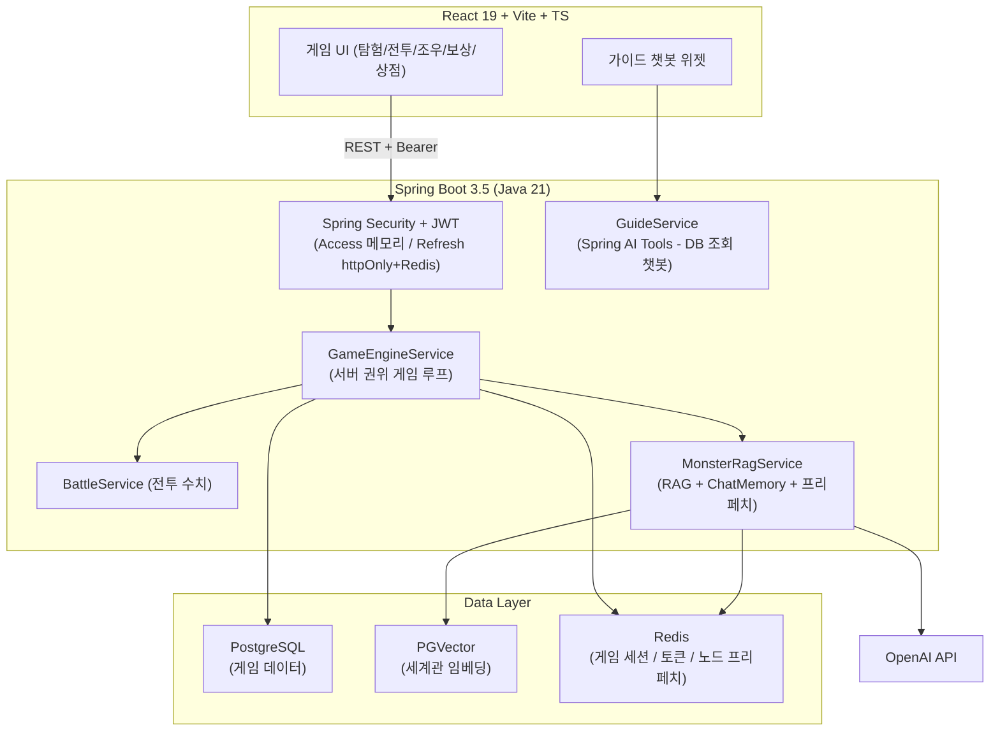

# Renova & Delve

> AI 스토리텔링 기반 로그라이크 웹게임 — 매 판마다 서사가 새로 쓰이는 '절차적 스토리텔링' RPG


## 프로젝트 소개

Renova & Delve는 LLM의 서사 생성 능력과 벡터 DB 기반 RAG를 결합한 **지능형 로그라이크**입니다.
악마와 계약한 왕 때문에 멸망한 왕궁을 5개 스테이지(각 10노드)에 걸쳐 잠입하고,
마지막 노드의 보스를 쓰러뜨려 마계 포탈을 봉인하면 클리어입니다.

핵심 설계 원칙은 **"비정형 서사 생성"과 "정형 수치 로직"의 분리**입니다.

- AI(RAG)는 노드의 **서사와 몬스터의 종류**만 결정합니다.
- 몬스터의 실제 능력치는 서버의 **필드 강도 시스템**(스테이지 × 난이도 확정 수치)이 부여합니다.
- 전투/보상/상점 등 모든 진행 상태는 **서버(Redis 세션)가 단일 소유**하며,
  클라이언트는 오직 "행동"만 보낼 수 있습니다. (조작 불가능한 서버 권위 구조)

## 게임 루프

```
탐험(EXPLORE) ─ 전진 ─▶ AI 노드 생성
   ▲                      ├─ 전투/강적/보스(BATTLE) ─ 승리 ─▶ 보상(REWARD) ─▶ 상점(SHOP) ─┐
   │                      └─ 조우(ENCOUNTER) ─ 선택지 결정 ──────────────────────────────┤
   └──────────────────────────────────────────────────────────────────────────────────┘
패배 시 GAMEOVER (불사조의 깃털 보유 시 1회 부활) · 5-10 보스 처치 시 CLEAR
게임 종료 시: 도감 등록 + 랭킹 갱신 + AI가 이번 모험을 요약한 서사 제공
```

- 전투: 턴제. 스킬(쿨타임/단일·전체/상태이상: 출혈·화상·독·기절) + 소모품(턴 소모)
- 성장: 처치 경험치로 레벨업(HP/공격/방어 상승), 상점에서 장비 교체·스킬/유물 구매
- 유물: 서버 로직으로 동작하는 패시브 (골드 획득↑, 스킬 피해↑, 쿨타임↓, 피해 감소 등)
- 난이도: EASY(랭킹 미등록) / NORMAL / HARD / HELL — 적 강도와 보상 배율에 반영

## 빠른 시작 (Quick Start)

### 사전 요구사항

| 항목 | 버전 | 용도 |
|---|---|---|
| Java | 21+ | 백엔드 |
| Node.js | 18+ | 프론트엔드 |
| Docker | 최신 | PostgreSQL(PGVector), Redis |
| OpenAI API Key | - | 서사 생성 / 임베딩 |

### 1. 인프라 실행 (Docker)

```bash
# PostgreSQL + PGVector (게임 DB + 벡터 스토어 통합)
docker run -d --name pgvector -e POSTGRES_PASSWORD=postgres -p 5432:5432 pgvector/pgvector:pg16
docker exec -it pgvector psql -U postgres -c "CREATE DATABASE renova_n_delve;"

# Redis (RefreshToken + 게임 세션 + AI 프리페치 캐시)
docker run -d --name redis -p 6379:6379 redis:7
```

### 2. 환경 변수

```bash
cd RenovaNDelve
cp .env.example .env
# JWT_SECRET_KEY, OPENAI_API_KEY 입력
```

### 3. 백엔드 실행

```bash
./gradlew bootRun
```

- 서버: `http://localhost:8080` / Swagger: `http://localhost:8080/swagger-ui/index.html`
- 기동 시 `db/data.sql`이 몬스터/스킬/장비/유물/필드 강도 시드를 자동 등록 (멱등)

### 4. (선택) 세계관 문서 ETL

RAG 품질을 높이려면 세계관/몬스터 문서를 벡터 스토어에 적재하세요.

```
POST /api/admin/etl  (multipart file 업로드 → 청크 분할 → 임베딩 → PGVector 저장)
```

문서가 없어도 게임은 동작합니다. (유사도 미달 시 랜덤 몬스터 폴백)

### 5. 프론트엔드 실행

```bash
cd ../renova-delve-front
npm install
npm run dev
```

- `http://localhost:5173` 접속 — `/api`는 Vite 프록시로 8080에 전달되어 CORS/쿠키 문제 없음

## 시스템 아키텍처



### 레이턴시 최적화

노드 진입 시 AI가 **다음 노드를 비동기로 미리 생성**(`AsyncPrefetchService`)해 Redis에 캐시합니다.
플레이어가 전투/상점을 진행하는 동안 다음 서사가 준비되므로 체감 대기가 거의 없습니다.
소비된 캐시는 즉시 삭제되어 같은 노드 재사용(리플레이)을 방지합니다.

## API 명세 (요약)

> 상세 스키마는 Swagger UI 참고. `/api/auth/**` 외 전부 JWT 필요.

| Method | URL | 설명 |
|---|---|---|
| POST | `/api/auth/signup` | 회원가입 |
| POST | `/api/auth/login` | 로그인 → `{accessToken}` + Refresh 쿠키 |
| POST | `/api/auth/refresh` | AccessToken 재발급 (쿠키 기반) |
| POST | `/api/auth/logout` | RefreshToken 폐기 |
| GET | `/api/member/me` | 내 정보 |
| GET | `/api/game/options` | 세팅 옵션 (장비/스킬/유물 + 예산 800pt) |
| POST | `/api/game/new` | 새 게임 (예산 서버 검증) |
| GET | `/api/game/current` | 현재 게임 뷰 (새로고침 복원) |
| POST | `/api/game/next` | 다음 노드 전진 (AI 생성) |
| POST | `/api/game/battle/skill` | 스킬 사용 (1턴) |
| POST | `/api/game/battle/consumable` | 소모품 사용 (턴 소모) |
| POST | `/api/game/encounter` | 조우 선택지 결정 |
| POST | `/api/game/reward` | 보상 선택 (SKIP 가능) |
| GET/POST | `/api/game/shop`, `/shop/buy`, `/shop/leave` | 상점 |
| GET | `/api/game/summary` | 종료 요약 (AI 서사 요약) |
| POST | `/api/game/abandon` | 게임 포기 |
| GET | `/api/ranking?difficulty=` | 난이도별 TOP 10 |
| GET | `/api/collection` | 내 도감 |
| POST | `/api/rag` | 가이드 챗봇 (Tools 기반 DB 조회) |
| POST | `/api/admin/etl` | 세계관 문서 ETL 업로드 |

## 기술 의사결정

**서버 권위(Server-Authoritative) 게임 세션** — 초기 설계는 클라이언트가 `GameStateEntity`와 몬스터 상태를 통째로 보내는 구조였으나, 이는 조작에 완전히 무방비였습니다. 전투 상태(몬스터 HP/버프), 조우 선택지의 숨겨진 결과, 보상 후보, 상점 재고를 전부 Redis의 `GameSession`으로 옮기고 클라이언트는 행동(스킬 슬롯 ID, 선택지 인덱스)만 보내도록 재설계했습니다.

**JWT 이중 토큰** — AccessToken(30분)은 프론트 메모리에만, RefreshToken(1일)은 httpOnly 쿠키 + Redis에 저장합니다. 새로고침 시 쿠키로 세션을 복원하고, Redis 대조로 탈취된 RefreshToken을 무효화할 수 있습니다.

**PGVector 단일 저장소** — 게임 데이터와 서사 임베딩을 한 PostgreSQL에서 관리해 동기화 오버헤드를 제거했습니다 (Single Source of Truth).

**AI 폴백** — OpenAI 호출이 실패해도 게임이 멈추지 않도록, 노드 생성 실패 시 랜덤 몬스터 + 기본 서사로 폴백합니다. AI는 게임의 '연출가'일 뿐 '심판'이 아니기 때문에 가능한 구조입니다.

## 프로젝트 구조

```
RenovaNDelve/                  # Spring Boot 백엔드
 ├─ engine/                    # GameSession(Redis 상태), RelicEffects(유물 패시브)
 ├─ service/
 │   ├─ GameEngineService*     # 게임 루프 오케스트레이터 (노드/전투/조우/보상/상점/종료)
 │   ├─ BattleService*         # 순수 전투 수치 계산 (치명타/상태이상/도트/반격)
 │   ├─ GameStateService*      # 게임 생성/세팅 옵션/포기
 │   ├─ BattleResultService*   # 도감 등록/랭킹/세션 종료
 │   ├─ ShopService*           # 상점 재고 생성/구매 적용
 │   ├─ ai/                    # MonsterRagService(RAG), GuideService(Tools), EtlService, 프리페치
 │   └─ redis/                 # GameSession/StageCache/SecurityToken 저장소
 ├─ controller/                # Game / Member / Ranking / Collection / AI
 └─ resources/db/data.sql      # 멱등 시드 (몬스터/스킬/장비/유물/필드 강도)

renova-delve-front/            # React 19 + Vite + TypeScript 프론트엔드
 ├─ src/api/                   # axios 클라이언트 (토큰 자동 재발급), 타입, API 함수
 ├─ src/context/AuthContext    # 세션 복원
 ├─ src/pages/                 # Auth / Home / Setup / Game / Result / Ranking / Collection
 └─ src/components/            # StatusBar, MonsterCard, TypewriterText, GuideChat
```

## 라이선스

MIT License
