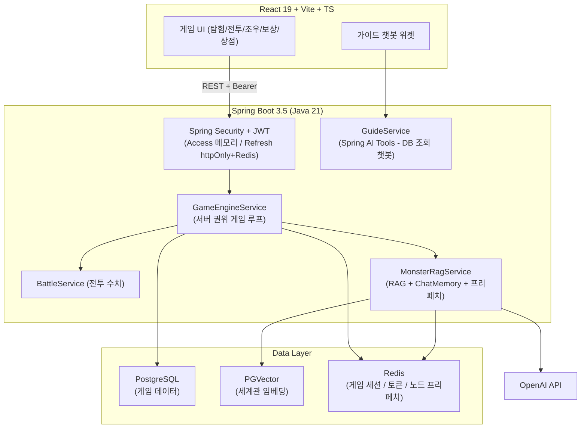

# Renova & Delve

> AI 스토리텔링 기반 로그라이크 웹게임 — 매 판마다 서사가 새로 쓰이는 '절차적 스토리텔링' RPG

**현재 버전: v0.5.0 (베타)** · 버전별 변경 내역은 [CHANGELOG.md](CHANGELOG.md)


## 프로젝트 소개

Renova & Delve는 LLM의 서사 생성 능력과 벡터 DB 기반 RAG를 결합한 **지능형 로그라이크**입니다.
천상(질서)과 마계(욕망) 사이에 낀 인간 왕국 레노바. 영생을 위해 악마와 계약한 왕 때문에 왕궁 지하에 마계의 문이 열렸고,
천상은 왕국을 통째로 정화하려 합니다. 플레이어는 5개 스테이지(각 10노드)를 내려가며 천상·마계·인간 중 누구의 방식으로
위기를 넘길지 고르고, 그 선택이 다음 장면의 서사와 결말을 바꿉니다.

핵심 설계 원칙은 **"비정형 서사 생성"과 "정형 수치 로직"의 분리**입니다.

- AI(RAG)는 노드의 **서사와 몬스터의 종류**만 결정합니다.
- 몬스터의 실제 능력치는 서버의 **필드 강도 시스템**(스테이지 × 난이도 확정 수치)이 부여합니다.
- 전투/보상/상점 등 모든 진행 상태는 **서버(Redis 세션)가 단일 소유**하며,
  클라이언트는 오직 "행동"만 보낼 수 있습니다. (조작 불가능한 서버 권위 구조)

## 프로젝트 이력

이 프로젝트는 **한 번 실패했다가 LLM으로 다시 살린 프로젝트**입니다.

| 시기 | 단계 | 내용 |
|---|---|---|
| 2026-07 | **v0.1 — 4인 팀 프로젝트** | 포트폴리오 목적의 팀 프로젝트로 시작. 엔티티·Repository 설계, Spring Security(JWT), Spring AI(RAG·Tools) 파이프라인까지 진행 |
| 2026-07 ~ 11 | **중단** | 팀원 간 실력 차이와 데드라인 초과로 미완성 상태에서 폐기. 게임 엔진은 동작하지 않았고, 프론트엔드는 저장소째 사라졌다 |
| 2026-11 ~ | **v0.2 ~ — LLM 재구축** | "프롬프트 지시만으로 어디까지 되는가"를 확인하려고, 코드를 직접 쓰지 않고 LLM(Claude)에게 지시·검토하는 방식으로 다시 구현 중 |

### 사람이 한 일과 LLM이 한 일

요즘 현업의 흐름처럼 **구현은 LLM이, 방향 결정과 검토는 사람이** 맡았습니다.

- **팀 시절 원본으로 남아 있는 것** — RAG 파이프라인(`MonsterRagService`의 압축기/확장기 분기·임계 점수 비교·프롬프트 설계), AI Tools(`GameTools`, 코드 그대로), JWT 유틸, 엔티티 20여 개의 테이블·FK 설계, Repository 쿼리
- **LLM이 다시 쓰거나 새로 만든 것** — 게임 엔진 전체(서버 권위 구조), 프론트엔드 100%, 회원·권한 체계, RDB → VectorStore ETL, 보안 결함 수정, 개인정보 처리, 도트 스프라이트 60종
- **사람이 한 것** — 무엇을 만들지 정하기, 직접 플레이하고 문제 찾기(스킬 교체 불가, 포션 버그, 관리자 자기 권한 회수 등), 모든 변경을 PR 리뷰로 받고 병합 결정

모든 변경은 기능 단위 PR로 올라가 있고, PR마다 "무엇을 했는지 / 무엇을 확인했는지 / 무엇을 확인하지 못했는지"와 리뷰가 남아 있습니다.

## 게임 루프

```
탐험(EXPLORE) ─ 전진 ─▶ AI 노드 생성
   ▲                      ├─ 전투/강적/보스(BATTLE) ─ 승리 ─▶ 보상(REWARD) ─▶ 상점(SHOP) ─┐
   │                      └─ 조우(ENCOUNTER) ─ 선택지 결정 ──────────────────────────────┤
   └──────────────────────────────────────────────────────────────────────────────────┘
패배 시 GAMEOVER (불사조의 깃털 보유 시 1회 부활) · 5-10 보스 처치 시 CLEAR
게임 종료 시: 도감 등록 + 랭킹 갱신 + AI가 이번 모험을 요약한 서사 제공
```

- 전투: 턴제. 스킬(쿨타임/단일·전체/상태이상: 출혈·화상·독·기절) + 소모품(턴 소모)
- 성장: 처치 경험치로 레벨업(HP/공격/방어 상승), 상점에서 장비 교체·스킬/유물 구매
- 유물: 서버 로직으로 동작하는 패시브 (골드 획득↑, 스킬 피해↑, 쿨타임↓, 피해 감소 등)
- 난이도: EASY(랭킹 미등록) / NORMAL / HARD / HELL — 적 강도와 보상 배율에 반영
- **전생의 망령**: 쓰러진 원정은 망령으로 남아, 다음 원정의 같은 자리에서 적으로 나타난다. AI는 그때 내린 선택을 기억하는 대사만 쓰고, 능력치·보상은 서버가 정한다. 처치하면 그 원정의 유물 하나를 되찾고, 세 번 달아나면 흩어진다

## 빠른 시작 (Quick Start)

### 사전 요구사항

| 항목 | 버전 | 용도 |
|---|---|---|
| Java | 21+ | 백엔드 |
| Node.js | 18+ | 프론트엔드 |
| Docker | 최신 | PostgreSQL(PGVector), Redis |
| OpenAI API Key | - | 서사 생성 / 임베딩 |

### 1. 인프라 실행 (Docker)

```bash
# PostgreSQL + PGVector (게임 DB + 벡터 스토어 통합)
docker run -d --name pgvector -e POSTGRES_PASSWORD=postgres -p 5432:5432 pgvector/pgvector:pg16
docker exec -it pgvector psql -U postgres -c "CREATE DATABASE renova_n_delve;"

# Redis (RefreshToken + 게임 세션 + AI 프리페치 캐시)
docker run -d --name redis -p 6379:6379 redis:7
```

### 2. 환경 변수

```bash
cd RenovaNDelve
cp .env.example .env
# JWT_SECRET_KEY, OPENAI_API_KEY 입력
```

**메일 (선택)** — 아이디 찾기·비밀번호 찾기 메일을 보내려면 `.env`에 SMTP 계정을 넣습니다. 비워 두면 서버는 그대로 기동되고 메일만 나가지 않습니다(로그에 경고).

```bash
MAIL_USERNAME=네이버_아이디
MAIL_PASSWORD=네이버_비밀번호_또는_애플리케이션_비밀번호
# MAIL_FROM=네이버_아이디@naver.com   # 비우면 MAIL_USERNAME@naver.com
# APP_BASE_URL=http://localhost:5173  # 재설정 링크가 가리킬 프론트 주소
```

- 네이버 메일 > 환경설정 > POP3/IMAP 설정에서 **POP3/SMTP 사용**을 켜야 합니다.
- 2단계 인증을 쓰는 계정은 네이버 계정 보안 설정에서 **애플리케이션 비밀번호**를 발급받아 넣습니다.
- 기본값은 `smtp.naver.com:465`(SSL)입니다. 587(STARTTLS)을 쓰려면 `MAIL_PORT=587`, `MAIL_SSL=false`.
- 계정 정보는 저장소에 넣지 않습니다(`.env`는 git에서 제외).

### 3. 백엔드 실행

```bash
./gradlew bootRun
```

- 서버: `http://localhost:8080` / Swagger: `http://localhost:8080/swagger-ui/index.html`
- 기동 시 Flyway가 스키마(`db/migration/V*.sql`)를 적용하고, 반복 마이그레이션 `R__seed_data.sql`이 몬스터/스킬/장비/유물/필드 강도 시드를 등록 (멱등, 내용이 바뀐 기동에서만 재실행)

### 4. 벡터 스토어 동기화 (자동)

기동하면 RDB의 게임 데이터 7종(몬스터·무기·갑옷·투구·스킬·유물·소모품)이 VectorStore와 자동으로 동기화됩니다.
바뀐 행만 다시 임베딩하므로 2회차 기동부터는 임베딩 API 호출이 거의 없습니다. 로그에서 `[GameDataETL] RDB 동기화 완료`를 확인하세요.

```
POST   /api/admin/etl/sync?force=false   # 수동 동기화 (force=true면 전부 다시 임베딩)
DELETE /api/admin/etl/purge              # RDB로 만든 문서 전체 삭제
```

AI 호출이 실패하거나 어울리는 몬스터를 찾지 못해도 게임은 동작합니다. (랜덤 몬스터 + 기본 서사로 폴백)

### 5. 프론트엔드 실행

```bash
cd ../renova-delve-front
npm install
npm run dev
```

- `http://localhost:5173` 접속 — `/api`는 Vite 프록시로 8080에 전달되어 CORS/쿠키 문제 없음

## 시스템 아키텍처



### 레이턴시 최적화

노드 진입 시 AI가 **다음 노드를 비동기로 미리 생성**(`AsyncPrefetchService`)해 Redis에 캐시합니다.
플레이어가 전투/상점을 진행하는 동안 다음 서사가 준비되므로 체감 대기가 거의 없습니다.
소비된 캐시는 즉시 삭제되어 같은 노드 재사용(리플레이)을 방지합니다.

## API 명세 (요약)

> 상세 스키마는 Swagger UI 참고. `/api/auth/**` 외 전부 JWT 필요.

| Method | URL | 설명 |
|---|---|---|
| POST | `/api/auth/signup` | 회원가입 |
| POST | `/api/auth/login` | 로그인 → `{accessToken}` + Refresh 쿠키 |
| POST | `/api/auth/refresh` | AccessToken 재발급 (쿠키 기반) |
| POST | `/api/auth/logout` | RefreshToken 폐기 |
| POST | `/api/auth/find-id` | 아이디 찾기 (이름 + 이메일 → 메일 발송, 응답은 항상 같음) |
| POST | `/api/auth/password-reset/request` | 비밀번호 재설정 링크 요청 (아이디 + 이메일, 응답은 항상 같음) |
| POST | `/api/auth/password-reset/confirm` | 1회용 토큰으로 새 비밀번호 설정 |
| PATCH | `/api/member/contact` | 이름·이메일 등록 / 변경 |
| GET | `/api/member/me` | 내 정보 |
| GET | `/api/game/options` | 세팅 옵션 (장비/스킬/유물 + 예산 800pt) |
| POST | `/api/game/new` | 새 게임 (예산 서버 검증) |
| GET | `/api/game/current` | 현재 게임 뷰 (새로고침 복원) |
| GET | `/api/game/wraith` | 기다리는 전생의 망령 (없으면 204) |
| POST | `/api/game/next` | 다음 노드 전진 (AI 생성) |
| POST | `/api/game/battle/skill` | 스킬 사용 (1턴) |
| POST | `/api/game/battle/consumable` | 소모품 사용 (턴 소모) |
| POST | `/api/game/encounter` | 조우 선택지 결정 |
| POST | `/api/game/reward` | 보상 선택 (SKIP 가능) |
| GET/POST | `/api/game/shop`, `/shop/buy`, `/shop/leave` | 상점 |
| GET | `/api/game/summary` | 종료 요약 (AI 서사 요약) |
| POST | `/api/game/abandon` | 게임 포기 |
| GET | `/api/ranking?difficulty=` | 난이도별 TOP 10 |
| GET | `/api/collection` | 내 도감 |
| POST | `/api/rag` | 가이드 챗봇 (Tools 기반 DB 조회) |
| POST | `/api/game/battle/guard`, `/battle/pass`, `/battle/flee` | 방어 태세 / 숨 고르기 / 도망치기 |
| POST | `/api/game/skill/discard` | 스킬 버리기 |
| GET | `/api/collection/totals` | 도감 분류별 전체 개수 |
| POST | `/api/admin/etl/sync` | RDB → VectorStore 동기화 (관리자) |

## 기술 의사결정

**서버 권위(Server-Authoritative) 게임 세션** — 초기 설계는 클라이언트가 `GameStateEntity`와 몬스터 상태를 통째로 보내는 구조였으나, 이는 조작에 완전히 무방비였습니다. 전투 상태(몬스터 HP/버프), 조우 선택지의 숨겨진 결과, 보상 후보, 상점 재고를 전부 Redis의 `GameSession`으로 옮기고 클라이언트는 행동(스킬 슬롯 ID, 선택지 인덱스)만 보내도록 재설계했습니다.

**JWT 이중 토큰** — AccessToken(30분)은 프론트 메모리에만, RefreshToken(1일)은 httpOnly 쿠키 + Redis에 저장합니다. 새로고침 시 쿠키로 세션을 복원하고, Redis 대조로 탈취된 RefreshToken을 무효화할 수 있습니다.

**PGVector 단일 저장소** — 게임 데이터와 서사 임베딩을 한 PostgreSQL에서 관리해 동기화 오버헤드를 제거했습니다 (Single Source of Truth).

**AI 폴백** — OpenAI 호출이 실패해도 게임이 멈추지 않도록, 노드 생성 실패 시 랜덤 몬스터 + 기본 서사로 폴백합니다. AI는 게임의 '연출가'일 뿐 '심판'이 아니기 때문에 가능한 구조입니다.

## 프로젝트 구조

```
RenovaNDelve/                  # Spring Boot 백엔드
 │  도메인별 모듈. 각 모듈 안은 controller / service / repository / domain / dto 계층
 ├─ game/                      # 게임 한 판
 │   ├─ engine/                # GameSession(Redis 상태), RelicEffects·SkillSynergies(조합), Alignment(가호), RunStats(통계)
 │   ├─ service/               # GameEngineService(게임 루프), BattleService(전투 계산), GameStateService(생성·포기),
 │   │                         #   BattleResultService(도감·랭킹·종료), ShopService, SkillSlotService
 │   └─ domain/                # GameStateEntity: 한 판의 스킬·유물·소모품을 소유하는 애그리거트 루트
 ├─ catalog/                   # 무기·갑옷·투구·스킬·유물·소모품·몬스터 원본 데이터
 ├─ member/                    # 회원, 관리자, 계정 복구, 개인정보
 ├─ auth/                      # JWT, 보안 필터·핸들러, 토큰 폐기
 ├─ collection/                # 도감
 ├─ ranking/                   # 랭킹
 ├─ ai/                        # MonsterRagService(RAG), GuideService, GameDataEtlService(RDB→벡터), 프리페치, tools/
 ├─ global/                    # 공용 설정, 예외 처리, 메일, 요청 제한
 └─ resources/db/migration/    # Flyway: V1 기준 스키마, R__seed_data 멱등 시드

renova-delve-front/            # React 19 + Vite + TypeScript 프론트엔드
 ├─ src/api/                   # axios 클라이언트 (토큰 자동 재발급), 타입, API 함수
 ├─ src/context/AuthContext    # 세션 복원
 ├─ src/pages/                 # Auth / Home / Setup / Game / Result / Ranking / Collection
 └─ src/components/            # StatusBar, MonsterCard, TypewriterText, GuideChat
```

## 라이선스

MIT License
